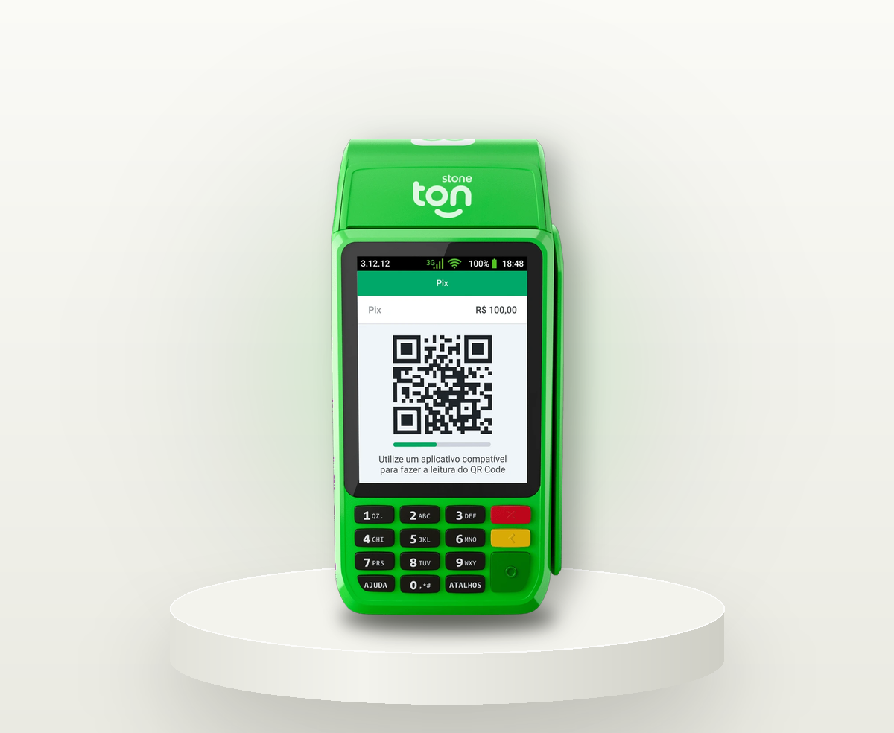
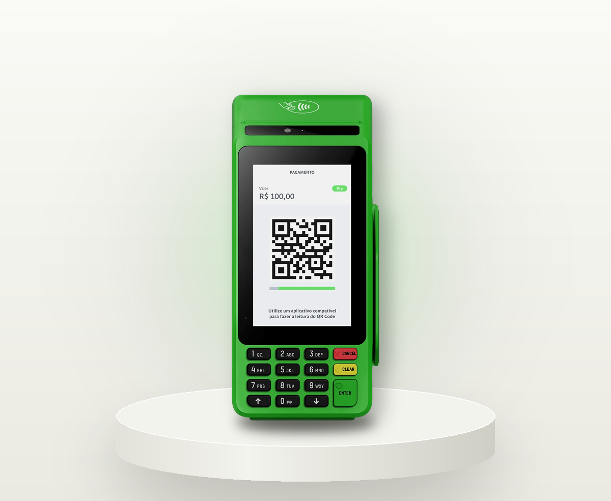
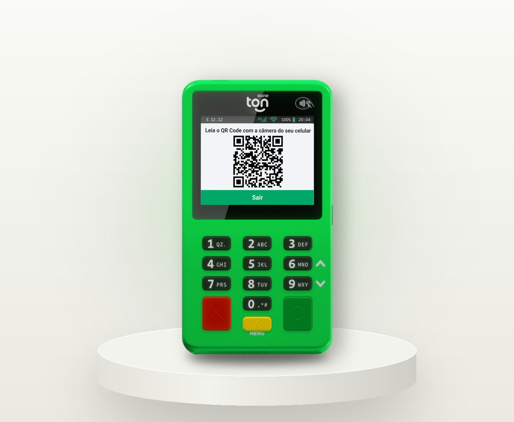
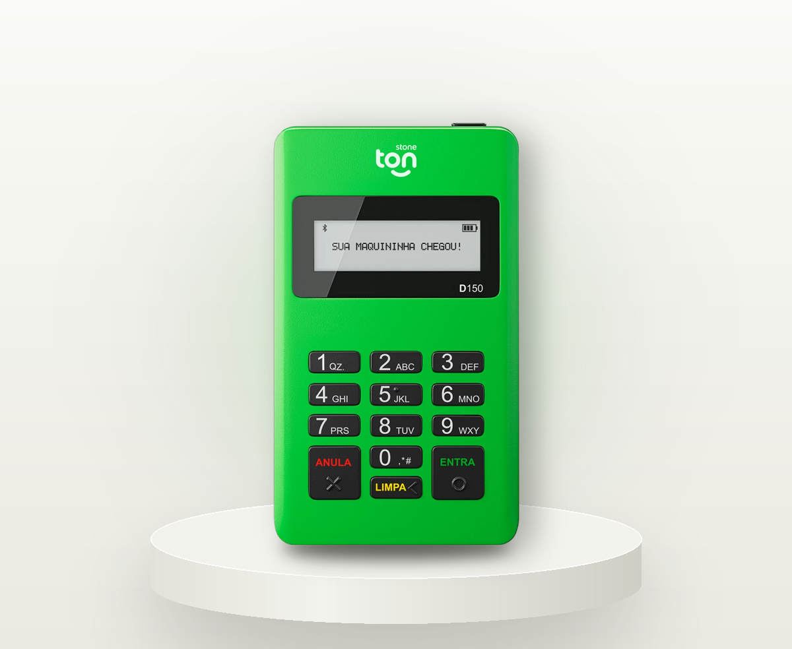

A melhor maquininha Ton, pelo critério deste site, é a <strong>T3</strong>: imprime, vende sem celular, recebe Pix e parcela em até 21x. A <strong>T3 Smart</strong> empata em recursos e soma tela touch. A <strong>T2</strong> entrega mais por real na rua. A <strong>T1</strong> é a entrada mais barata, para quem já usa o celular.

## Por que a T3 lidera e o que cada modelo faz

O ranking mede uma coisa só. Em quantas situações a máquina deixa você vender? Cada um dos seis recursos de venda da metodologia vale um ponto. O desempate é o preço. A conta inteira está na seção de metodologia, para você refazer com o seu peso.

### 1º Ton T3: a mais barata entre as que imprimem e parcelam em 21x

A T3 resolve o balcão. Imprime o comprovante e a bobina é grátis, segundo a página do modelo <Fonte id="TN-F067" />. Tem chip e Wi-Fi, então vende sem depender do celular. Recebe Pix por QR Code ou por aproximação <Fonte id="TN-F067" />.

Parcela em até 21x <Fonte id="TN-F070" />. Com CNPJ, aceita vale-alimentação e refeição <Fonte id="TN-F074" />.

A Ton mostra <Preco modelo="t3" de /> com 72% OFF. Em 27 de outubro de 2026 cobrava <Preco modelo="t3" /> à vista, ou <Preco modelo="t3" parcela /> <Fonte id="X-melhor-maquininha-ton-03" />.

O que ela não tem: tela touch e Android <Fonte id="TN-F069" />. A página da T3 fala em chip 3G <Fonte id="TN-F067" />.

### 2º Ton T3 Smart: a mesma nota, com tela touch e Android

Ela faz tudo o que a T3 faz no critério. E soma sistema Android, tela touch, chip 4G e o que a Ton chama de bateria de longa duração <Fonte id="TN-F068" />.

Custa <Preco modelo="t3-smart" /> à vista, com <Preco modelo="t3-smart" de /> e 71% OFF na página, ou <Preco modelo="t3-smart" parcela /> <Fonte id="X-melhor-maquininha-ton-04" />. São R$ 83,88 a mais que a T3. A taxa promocional exibida na página dos dois modelos é a mesma <Fonte id={['X-melhor-maquininha-ton-05', 'X-conferencia-27out-09']} />.

Pagar a diferença faz sentido quando a tela vai ser usada o dia inteiro. Sem esse uso, é dinheiro parado no aparelho.

### 3º Ton T2: vende na rua com Pix na máquina

A T2 cabe no bolso. Tem chip, Wi-Fi e aproximação, e recebe Pix por QR Code ou por aproximação <Fonte id="TN-F066" />. Com CNPJ, aceita vale <Fonte id="TN-F074" />.

Custa <Preco modelo="t2" /> à vista, com <Preco modelo="t2" de /> e 72% OFF na página, ou <Preco modelo="t2" parcela /> <Fonte id="X-melhor-maquininha-ton-02" />. Divida o preço pelos quatro recursos: dá R$ 10,59 por recurso. É a conta mais eficiente do ranking.

Ela não imprime. O comprovante vai por SMS <Fonte id="TN-F069" />.

<Callout tipo="conflito" titulo="A T2 parcela em 21x?">

A página de maquininhas da Ton diz que T1 e T2 param em 12x <Fonte id="TN-F070" />. Dois posts do blog da Ton falam em 18x e 21x na T2, menos o modelo D188 <Fonte id={['X-parcelado-03', 'X-parcelado-07']} />. Se o seu negócio depende do 21x, peça T3 ou T3 Smart.

</Callout>

### 4º Ton T1: a mais barata, para quem já usa o celular

A T1 conecta no celular por Bluetooth, e o celular precisa ter internet <Fonte id="TN-F065" />. Recebe por aproximação e manda o comprovante por SMS <Fonte id="TN-F069" />.

Custa <Preco modelo="t1" /> à vista, com <Preco modelo="t1" de /> e 70% OFF na página, ou <Preco modelo="t1" parcela /> <Fonte id="X-melhor-maquininha-ton-01" />.

A nota é 1. Ela não recebe Pix na máquina <Fonte id="X-modelo-t1-04" />, não imprime e para em 12x <Fonte id="TN-F070" />. Mesmo assim, para quem vende pouco e não quer gastar na entrada, ela é a escolha certa.

## Quais maquininhas Ton evitar no seu caso

Toda máquina tem um caso em que não serve. Confere o seu antes de pedir.

### Evite a T1 se você precisa de Pix, papel ou vender sem celular

Sem celular com internet, a T1 não vende <Fonte id="TN-F065" />. Pix na máquina e comprovante impresso ficam de fora <Fonte id="TN-F069" />. Em vez dela, pegue a T2 se não precisa de papel. Pegue a T3 se precisa.

### Evite a T2 se o cliente pede papel ou mais de 12x

A T2 só manda SMS <Fonte id="TN-F069" />. Na página de vendas, ela para em 12x <Fonte id="TN-F070" />. Quem entrega comprovante impresso no balcão ou vende produto caro em 18x vai sentir falta. A diferença entre as duas está em [T2 ou T3, o que decide](/modelos/ton-t2-ou-t3/).

### Evite a T3 se você não usa papel nem parcela longa

A T3 custa R$ 65,64 a mais que a T2. Sem comprovante impresso e sem 21x, essa diferença paga uma impressora parada. Fique com a T2.

### Evite a T3 Smart se a tela touch não vai ser usada

São R$ 83,88 a mais que a T3, com a mesma taxa promocional exibida <Fonte id={['X-melhor-maquininha-ton-05', 'X-conferencia-27out-09']} />. A tela é conforto de operação. Não muda se a venda acontece.

### Evite contar com vale se você não tem CNPJ

Vale-alimentação e refeição só funcionam em cadastro com CNPJ <Fonte id="TN-F074" />. E a ativação não é automática: a Ton manda negociar taxa e prazo com cada bandeira de vale <Fonte id="X-cartoes-e-vales-04" />.

## Melhor maquininha Ton por tipo de negócio

Ache a sua linha. O modelo de partida resolve a maioria dos casos. A última coluna diz quando subir ou descer um degrau.

<table>
<caption>Modelo Ton de partida por tipo de negócio, pelos recursos das páginas oficiais conferidas em 27/10/2026</caption>
<thead><tr><th scope="col">Negócio</th><th scope="col">Comece pela</th><th scope="col">Por quê</th><th scope="col">Quando trocar</th></tr></thead>
<tbody>
<tr><th scope="row">Loja com balcão</th><td>T3</td><td>Imprime o comprovante e parcela em até 21x</td><td>T3 Smart se o caixa roda o dia todo na tela</td></tr>
<tr><th scope="row">Salão de beleza</th><td>T3</td><td>Parcela acima de 12x e imprime o comprovante</td><td>T2 se o salão não entrega papel nem passa de 12x</td></tr>
<tr><th scope="row">Barbearia</th><td>T2</td><td>Pix na máquina, sem depender do celular</td><td>T3 se o cliente pede comprovante</td></tr>
<tr><th scope="row">Feira e ambulante</th><td>T2</td><td>Chip e Wi-Fi próprios, cabe no bolso</td><td>T1 se vende pouco e aceita usar o celular</td></tr>
<tr><th scope="row">Delivery e food truck</th><td>T2</td><td>Vende sozinha na porta do cliente, com Pix</td><td>T3 se precisa entregar papel</td></tr>
<tr><th scope="row">Restaurante e lanchonete com vale</th><td>T2, T3 ou T3 Smart</td><td>As três aceitam vale com CNPJ</td><td>Escolha pelo papel: T3 se entrega comprovante</td></tr>
<tr><th scope="row">Quem está começando</th><td>T1</td><td>Menor preço de entrada, usa o celular</td><td>T2 quando quiser vender sem o celular</td></tr>
</tbody>
</table>

Os recursos da tabela vêm da comparação da Ton <Fonte id="TN-F069" />, das páginas de cada modelo <Fonte id={['TN-F065', 'TN-F066', 'TN-F067', 'TN-F068']} />, da regra do 21x <Fonte id="TN-F070" /> e do aviso de vales <Fonte id="TN-F074" />.

## Como escolher: o aparelho decide o recurso, as vendas decidem a taxa

Duas decisões diferentes. Não misture as duas.

### O aparelho decide o recurso

1. **Vai vender sem o celular?** Se sim, a T1 sai da conta <Fonte id="TN-F065" />.
2. **Precisa de Pix na máquina?** Se sim, T2, T3 ou T3 Smart <Fonte id="TN-F069" />.
3. **Precisa de papel?** Se sim, T3 ou T3 Smart <Fonte id="TN-F069" />.
4. **Vende parcelado acima de 12x?** Se sim, T3 ou T3 Smart <Fonte id="TN-F070" />.
5. **Recebe vale?** Se sim, precisa de CNPJ e de T2, T3 ou T3 Smart <Fonte id="TN-F074" />.

<Callout tipo="conflito" titulo="A T1 aceita vale?">

A tabela de comparação da Ton marca sim para os quatro modelos <Fonte id="TN-F069" />. O aviso de bandeiras de vale cita só T2, T3 e T3 Smart <Fonte id="TN-F074" />. Se você vai receber vale, não conte com a T1.

</Callout>

### As vendas decidem a taxa

A máquina mais cara não cobra menos. A taxa promocional exibida é igual nas quatro páginas de modelo <Fonte id={['X-conferencia-27out-07', 'X-conferencia-27out-08', 'X-melhor-maquininha-ton-05', 'X-conferencia-27out-09']} />. Ela vale por 30 dias ou até R$ 5 mil em vendas, o que vier primeiro <Fonte id={['TN-F011', 'X-melhor-maquininha-ton-06']} />. Passou de R$ 5 mil antes dos 30 dias? Até fechar o período, valem as taxas da faixa de R$ 6 mil a R$ 10 mil <Fonte id="TN-F013" />.

Depois, a Ton soma no início de cada mês o que você vendeu no mês anterior. Isso define a sua taxa <Fonte id="X-melhor-maquininha-ton-07" />. A faixa pode subir ou descer todo mês <Fonte id="TN-F180" />. São cinco faixas <Fonte id="TN-F012" />:

<TabelaFaixas prazo="d1" destaque="ate3k" />

Na faixa de até R$ 3 mil, o crédito à vista sai a <Taxa faixa="ate3k" prazo="d1" tipo="credito1x" /> recebendo em 1 dia útil. Na promoção, sai a <Taxa faixa="promo" prazo="d1" tipo="credito1x" />. Quer ver quanto cai de cada venda? Use o [simulador de taxas por venda](/quanto-custa/simulador-de-taxas/).

Fora da promoção, o prazo de recebimento também muda a taxa <Fonte id="TN-F014" />. O Pix tem regra própria <Fonte id="TN-F010" />. O simulador mostra os dois na mesma tela.

### O que vale para as quatro

A máquina é comodato: ela não passa a ser sua <Fonte id="TN-F016" />. Você paga uma adesão única, à vista ou em até 12x, sem aluguel nem mensalidade <Fonte id="TN-F071" />. A garantia é ilimitada, com troca e manutenção grátis <Fonte id="TN-F075" />. O frete é grátis nas quatro páginas <Fonte id={['X-melhor-maquininha-ton-01', 'X-melhor-maquininha-ton-02', 'X-melhor-maquininha-ton-03', 'X-melhor-maquininha-ton-04']} />. E a Ton aceita PF, PJ ou MEI <Fonte id="X-melhor-maquininha-ton-09" />.

## Metodologia: como o ranking foi montado sem teste em mãos

Este site não pôs os aparelhos à prova. A nota mede o que a Ton publica, não o desempenho do aparelho na sua mão. Foi assim:

1. **Só fonte oficial, com data.** Páginas de modelo, comparação, planos e regulamento do Ton Mega+, reabertos em 27 de outubro de 2026. A tabela de planos segue com data de atualização de 1º de outubro <Fonte id="X-melhor-maquininha-ton-13" />.
2. **Seis recursos de venda, um ponto cada.** Recurso de venda é o que decide se a venda acontece.
3. **Na dúvida, zero.** Onde a Ton se contradiz, o modelo não ganha o ponto.
4. **Empate vai para o mais barato.**

<table>
<caption>Recursos de venda publicados pela Ton, um ponto cada (conferido em 27/10/2026)</caption>
<thead><tr><th scope="col">Recurso</th><th scope="col">T1</th><th scope="col">T2</th><th scope="col">T3</th><th scope="col">T3 Smart</th></tr></thead>
<tbody>
<tr><th scope="row">Vende sem celular</th><td>0</td><td>1</td><td>1</td><td>1</td></tr>
<tr><th scope="row">Pix na máquina</th><td>0</td><td>1</td><td>1</td><td>1</td></tr>
<tr><th scope="row">Comprovante impresso</th><td>0</td><td>0</td><td>1</td><td>1</td></tr>
<tr><th scope="row">Aproximação</th><td>1</td><td>1</td><td>1</td><td>1</td></tr>
<tr><th scope="row">Mais de 12x</th><td>0</td><td>0</td><td>1</td><td>1</td></tr>
<tr><th scope="row">Vale com CNPJ</th><td>0</td><td>1</td><td>1</td><td>1</td></tr>
<tr><th scope="row">Nota</th><td>1</td><td>4</td><td>6</td><td>6</td></tr>
</tbody>
</table>

As fontes de cada linha: comparação da Ton <Fonte id="TN-F069" />, páginas de modelo <Fonte id={['TN-F065', 'TN-F066', 'TN-F067', 'TN-F068']} />, regra do parcelamento <Fonte id="TN-F070" /> e aviso de vales <Fonte id="TN-F074" />.

Dois zeros vêm da regra da dúvida. A T2 e o 21x: a página de vendas diz 12x, o blog diz 21x <Fonte id={['TN-F070', 'X-parcelado-03']} />. A T1 e o vale: a comparação marca sim, o aviso de bandeiras cita só T2, T3 e T3 Smart <Fonte id={['TN-F069', 'TN-F074']} />.

T3 e T3 Smart empatam em 6. A T3 custa <Preco modelo="t3" /> e a T3 Smart, <Preco modelo="t3-smart" /> <Fonte id={['X-melhor-maquininha-ton-03', 'X-melhor-maquininha-ton-04']} />. Por isso a T3 fica em 1º.

Ficaram fora da nota, e o motivo:

- **Tela touch e Android.** Conforto de operação, só na T3 Smart <Fonte id="TN-F069" />.
- **Chip 4G.** A comparação diz 4G, as páginas da T2 e da T3 dizem 3G <Fonte id={['TN-F069', 'TN-F066', 'TN-F067']} />. Conflito.
- **Bateria.** A Ton não publica horas de bateria nas páginas conferidas. Diz só "longa duração" para a T3 Smart <Fonte id="TN-F068" />.
- **Taxa, garantia, frete e mensalidade.** Iguais nas quatro. A taxa promocional exibida <Fonte id={['X-conferencia-27out-07', 'X-conferencia-27out-08', 'X-melhor-maquininha-ton-05', 'X-conferencia-27out-09']} />, a garantia <Fonte id="TN-F075" />, a adesão sem mensalidade <Fonte id="TN-F071" /> e o frete grátis <Fonte id={['X-melhor-maquininha-ton-01', 'X-melhor-maquininha-ton-02', 'X-melhor-maquininha-ton-03', 'X-melhor-maquininha-ton-04']} />.
- **Comissão.** Este site recebe por indicação: R$ 40 pela T1, R$ 50 pela T2, R$ 150 pela T3 e R$ 170 pela T3 Smart, no nível inicial do programa <Fonte id="TN-F034" />. A T3 Smart paga mais e ficou em 2º.

Reputação, com número e data: no Reclame Aqui, a Ton tinha selo RA1000 e nota 9,1 de 10 nos últimos seis meses, com dados de 1º de abril a 30 de setembro de 2026 <Fonte id="X-melhor-maquininha-ton-08" />.

Um detalhe de entrega. O nome do modelo é uma família de aparelhos. A T3 pode chegar como S920, Q60, Q92, D230 ou MP35P <Fonte id="X-melhor-maquininha-ton-11" />. A T2 tem quatro aparelhos na família <Fonte id="X-modelo-t2-01" />, e a T1 também <Fonte id="TN-F091" />. A T3 Smart traz chip 3G e 4G, Wi-Fi e Android em todos <Fonte id="X-melhor-maquininha-ton-12" />.

## Antes de pedir: três conferências

1. **Confere o preço no carrinho da Ton.** O desta página foi conferido em 27 de outubro de 2026. O preço é promocional e muda sem aviso.
2. **Cadastra a chave Pix logo depois de ativar.** É ela que mantém o Pix na máquina em zero depois dos 30 dias <Fonte id="TN-F010" />.
3. **Vende acima de R$ 3 mil por mês? Simula a sua faixa antes.** Depois da promoção, a taxa depende da faixa em que você cair <Fonte id={['TN-F180', 'X-correcoes-b-08']} />.

Se você tem balcão e entrega papel, comece pela T3. Se vende na rua e quer Pix na máquina, comece pela T2. Se ainda está em dúvida entre as duas, responda [as três perguntas que decidem](/modelos/qual-maquininha-ton-escolher/) e volte ao card do modelo.

Quem tem CNPJ e fatura alto pode olhar o Ton Black, que a Ton descreve com taxas reduzidas para alto faturamento <Fonte id="TN-F098" />.
